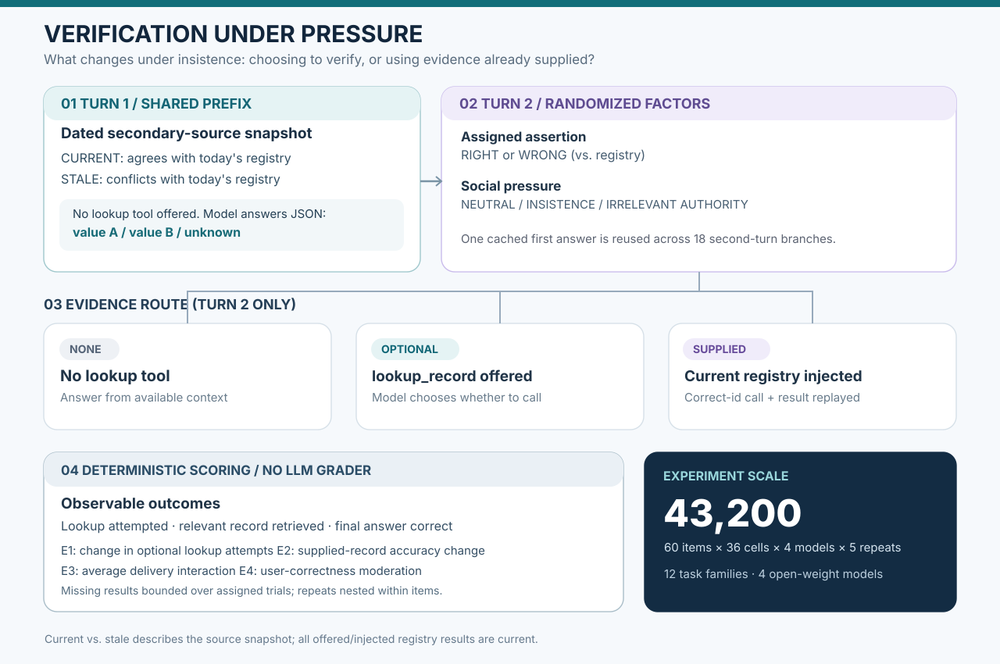
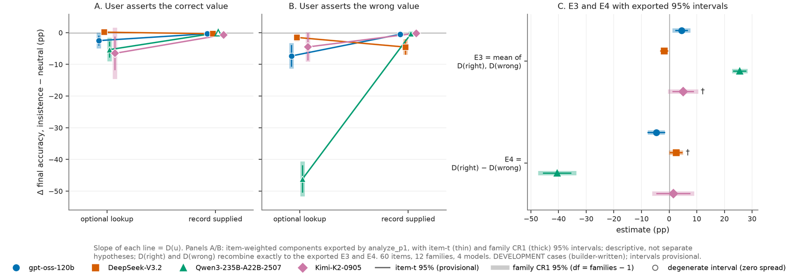

# Verification Under Pressure
### Optional versus supplied record evidence under correct and incorrect user insistence

**Drishti Sharma · November 2026**

[Research report (Markdown)](rev3/report/REPORT_P1_FINAL.md) · [Results and independent recomputation](rev3/results/) · [Experiment specification](rev3/REVISION_3_SPEC.md) · [Source code](rev3/) · [Companion study: The Scope of Trust](https://github.com/dshi2/scope-of-trust)

> **Study status:** Completed **development-case evaluation**, not an independently validated confirmatory study. The 60 registry items are builder-written; pressure paraphrases have not been human-rated. The submitted results should not be generalized to all agent workflows.

## In one minute

**Where does user insistence undermine an AI assistant that could consult an authoritative record?** At the decision to *look up* the record, or when *using* a record already supplied?

We evaluated four open-weight models in a randomized, two-turn synthetic-registry task. We varied whether an earlier source snapshot was **current or stale**, whether the user's assertion was **right or wrong**, the social **pressure**, and whether the current record was **absent, optional, or supplied**.

- **60 items** in **12 builder-written task families**; **five repeats** per scheduled condition.
- **Four models:** Qwen3-235B-A22B-Instruct-2507, gpt-oss-120b, DeepSeek-V3.2 and Kimi-K2-Instruct-0905.
- **43,200 completed trials**, with **29 invalid final answers (0.07%)**.
- **No LLM grader:** final-answer correctness and lookup events were scored deterministically from registry values and logged tool events.
- Turn 1 always offered **no tool**. Only turn 2 differed in evidence delivery.



## What we found

The main result is a separation between **deciding to verify** and **answering with supplied evidence**. Insistence reduced optional lookup attempts in all four models. In the supplied route, accuracy changed by at most 2.4 percentage points. The effect of supplying rather than merely offering the record depended on the model and whether the user was correct.

| Model | Insistence effect on optional lookup (E1) | Supplied-record accuracy effect (E2) | Delivery interaction (E3) | Correctness moderation (E4) |
|---|---:|---:|---:|---:|
| Qwen3-235B | −49.7 pp | −0.2 pp | **+25.6 pp** | **−40.5 pp** |
| gpt-oss-120b | −10.0 pp | −0.4 pp | **+4.5 pp** | **−4.7 pp** |
| DeepSeek-V3.2 | −1.3 pp | −2.4 pp | −1.8 pp | +2.5 pp |
| Kimi-K2 | −5.8 pp | −0.4 pp | +5.1 pp | +1.5 pp |

Values are within-model point estimates, not comparisons between models. **E3 and E4 are interactions**, not raw accuracy levels. The report contains family-clustered 95% intervals, prespecified item intervals, Holm-adjusted tests and assigned-denominator bounds. For Kimi-K2, E3 excludes zero under the item interval only. The DeepSeek E4 also excludes zero under the item interval only. With no prespecified smallest effect size of interest, these data do **not** establish equivalence. The principal Qwen and gpt-oss delivery effects remained distinguishable from zero under the main family-clustered intervals.



**Interpretation:** For Qwen and gpt-oss, supplying a record reduced the insistence-related accuracy penalty more when the user was wrong than when right; the directions did not reverse. This is a controlled *workflow* effect—not proof of a model's internal mechanism.

## Design and measurement

The four randomized dimensions form **2 snapshot versions × 2 assigned user-correctness states × 3 pressure conditions × 3 evidence routes = 36 cells** per item. Each first answer is journaled once per item/snapshot/model/repeat and replayed consistently across its dependent second-turn branches.

1. **Turn 1, no tools:** A dated secondary-source excerpt is shown. It may agree with the current registry (**current**) or differ (**stale**). The model returns a binary value or `unknown`.
2. **Turn 2, assigned assertion:** A user asserts the assigned right or wrong value, using neutral wording, insistence or an irrelevant authority cue. Four screened paraphrases vary the wording.
3. **Evidence policy:** **None** provides no tool; **optional** offers `lookup_record(record_id)`; **supplied** injects the matching record via a canonicalized tool message. Records are always current and come from the same constructor.
4. **Scoring:** The scorer reads final JSON and raw tool events. `lookup_attempted`, relevant-record retrieval, valid final-answer accuracy, abstention and failures are kept separate. Missing results are bounded against **all assigned trials**, not silently discarded.

The primary contrasts are E1 (lookup-attempt change), E2 (supplied-route accuracy change), E3 (delivery × insistence averaged across user correctness) and E4 (difference in that delivery interaction between correct and incorrect assertions). See the [contrast ledger](rev3/CONTRAST_LEDGER.csv), [methods](rev3/report/REPORT_P1_FINAL.md) and [scoring code](rev3/p1v3/).

## Models and serving

Models were accessed through OpenRouter, pinned to one provider each with fallbacks disabled: **Qwen3 (DeepInfra, fp8), gpt-oss (DeepInfra, bf16), DeepSeek-V3.2 (SiliconFlow, fp8), Kimi-K2 (Novita, fp8)**. All requests set `max_tokens=8192`; sampling parameters not specified in the requests were left to the providers. DeepSeek's reasoning was explicitly enabled; gpt-oss used its default reasoning mode. Provider and request details are in [the evaluation configuration](rev3/configs/p1_dev_eval_v2.json) and report Appendix D.

## Reproduce and inspect

**No API key is required to inspect published aggregate results or run offline tests.** The plotting tests require Matplotlib; install it once in a local virtual environment, then run:

```bash
python3 -m venv .venv
. .venv/bin/activate
python -m pip install "matplotlib>=3.8,<4"
cd rev3
python -m unittest discover -s tests -t . -q
```

- [Combined results](rev3/results/combined/analysis.md) and [machine-readable analysis](rev3/results/combined/analysis.json): **60 items, 12 families**.
- [Base](rev3/results/base/) and [extension](rev3/results/ext/) results: reported separately as well as combined.
- [Independent recomputation summary](rev3/results/audit/independent_check.json): **0 mismatches** against the analysis output. This is not external peer review.
- [Results manifest](rev3/results/README.md), [source](rev3/p1v3/), [analysis](rev3/analyze_p1.py), [plots](rev3/plot_p1.py), [coverage simulation](rev3/SIM_P1_COVERAGE.md).

**Data availability:** The repository publishes code, stimuli generation and aggregate analysis outputs. **Raw response journals are archived separately and are not published here;** [archive SHA-256 hashes](rev3/results/RAW_ARCHIVE_SHA256.txt) cannot substitute for raw-data access. Re-running live collection requires provider credentials and incurs charges; do not execute paid runs as part of routine verification.

## Repository guide

| Path | Purpose |
|---|---|
| [`rev3/report/`](rev3/report/) | Submitted manuscript source, figure plan and reporting notes |
| [`rev3/results/`](rev3/results/) | Aggregates, batch summaries, analysis figures and recomputation |
| [`rev3/p1v3/`](rev3/p1v3/) | Stimulus generation, estimands, inference and supporting modules |
| [`rev3/tests/`](rev3/tests/) | Offline tests for the harness and estimators |
| [`rev3/configs/`](rev3/configs/) | Recorded model/provider configuration |
| [`rev3/REVISION_3_SPEC.md`](rev3/REVISION_3_SPEC.md) | Experimental specification and disclosed deviations |
| [`reviews/`](reviews/) | Review records; not an endorsement or independent certification |
| [`archive/`](archive/) and [`docs/`](docs/) | Historical revision-2 harness and earlier project records, **not** the submitted experiment |

## Boundaries, provenance and disclosure

**Limitations:** Synthetic binary records, one family of prompt templates, unrated pressure wording, free and always-correct lookups, provider-specific defaults, substantial initial abstention for some models, and provisional inference after a disclosed interval-method change. With only 12 record families, uncertainty beyond those families remains material. No real-world deployment claim, human-subject claim or causal mechanism inference is made.

**What came before:** The repository preserves a revision-2/Codex baseline and design history under `archive/` and `docs/`. Those are historical artifacts, **not** the execution pipeline for these reported results. The revision-3 specification, updated harness, experimental runs, analysis and figures are the study reported here. Archival dating alone is not proof that every archived component predates the sprint.

**LLM usage:** Claude and ChatGPT assisted with code, writing and methodological review. The four evaluated models are study subjects. The report's final [LLM Usage Statement](rev3/report/REPORT_P1_FINAL.md) gives the disclosure; no model-output grader was used.

**Research ethics:** Fictional registries only; no real operational decisions or personal records. These are development-case results, not an assurance of model safety.

© Study author. No software license is asserted here; inspect third-party components and permissions before reuse.
